<p align="center">
  
</p>

<h1 align="center">PromptVault</h1>

<p align="center"><strong>Your creative memory for AI.</strong><br/>
Save what you create. Remember how you created it. Find it when you need it.</p>

<p align="center">
  <a href="https://kapoorraghav-cmd.github.io/promptvault/"><strong>Try the live app</strong></a> ·
  <a href="#getting-started">Run it locally</a> ·
  <a href="#backup-and-restore">Backup guide</a> ·
  <a href="#roadmap">Roadmap</a>
</p>

<p align="center">
  <a href="https://github.com/kapoorraghav-cmd/promptvault/actions/workflows/ci.yml"></a>
  <a href="LICENSE"></a>
</p>

<p align="center">
  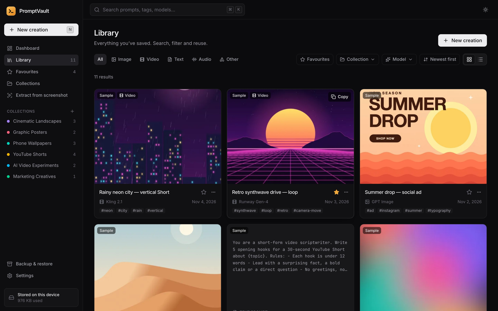
</p>

---

PromptVault is a free, open-source personal library for people who create with generative AI. Save your prompts together with the images they produced, the model you used and the settings that worked — then search, organise and reuse them whenever you need to.

It runs entirely in your browser. There's no account to create, no subscription, no API key and no server. Your library is stored on your own device.

## Why PromptVault exists

If you use AI tools regularly, you've probably:

- lost a prompt that produced a great result,
- forgotten which model, seed or aspect ratio you used,
- kept screenshots of prompts instead of the text,
- ended up with AI images scattered across downloads folders, chats and platforms.

PromptVault keeps the prompt, the result and the "how" together in one place, so your best work is easy to find and easy to repeat.

## Features

**Save everything about a creation**
- Title, prompt, negative prompt, notes, AI tool/model, category, tags and creation date
- Generation details: aspect ratio, resolution, seed, other settings and source URL
- Content types for images, video, text, audio and other work
- Save incomplete records and fill them in later

**Images and video**
- Attach several images per creation by choosing files, dragging them in or pasting from the clipboard
- Preview before saving, mark each image as a result, reference or thumbnail, pick a cover, and add alt text and captions
- Originals are stored untouched; small previews keep the grid fast
- Full-size viewer with keyboard navigation and "download original"
- Video records save the video link, duration and a thumbnail. PromptVault stores a link only and never claims to have downloaded your video

**Find and organise**
- Instant search across titles, prompts, tags, models, categories and notes — all on your device
- Filter by type, collection, model, tag and favourites; sort by newest, oldest, recently edited or title
- Grid and list views
- Collections (an item can belong to several), tags and favourites
- One-click copy, with a "recently used prompts" list on the dashboard

**Iterate on prompts**
- Duplicate any prompt as a variation and edit it without touching the original
- Every variation records which prompt it came from and when
- Compare two versions side by side with word-level highlighting of what changed

**Extract prompts from screenshots**
- Upload or paste a screenshot of a prompt and turn it back into editable text
- Uses the open-source [Tesseract](https://github.com/naptha/tesseract.js) OCR engine, bundled with the app and running on your device. Screenshots are never uploaded
- Review and correct the text, then save it as a new creation (optionally keeping the screenshot as a reference)

**Own your data**
- Full backup as a `.zip` (all data plus original images), data-only `.json`, or readable Markdown
- Export a single item or selected collections
- Import with a preview, validation of every record and a choice for duplicates: keep yours, replace, or keep both
- Damaged or unrelated files are rejected with a clear message and nothing is changed

**Polished experience**
- Dark theme by default, plus light and "follow my system"
- Works on desktop, tablet and phone
- First-run tour and an optional sample library you can remove in one click
- Storage usage, a request to protect your data from automatic browser clean-up, and a "clear everything" option with strong confirmation

## Screenshots

All screenshots below are of the real app running the built-in sample library.

| Dashboard | Creation details |
| --- | --- |
| 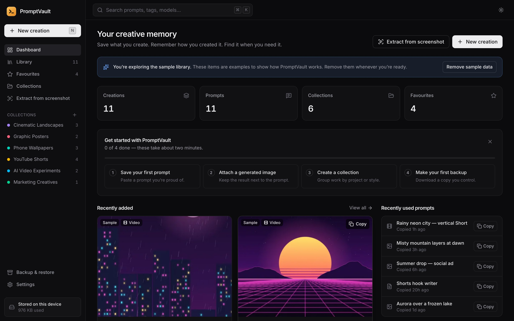 | 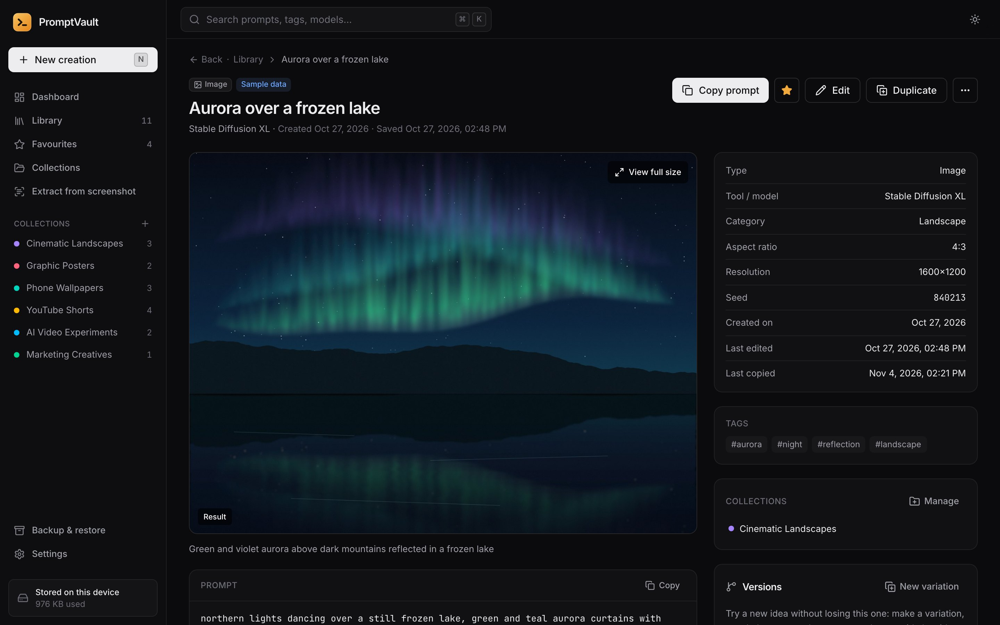 |
| **Add or edit a creation** | **Compare two prompt versions** |
| 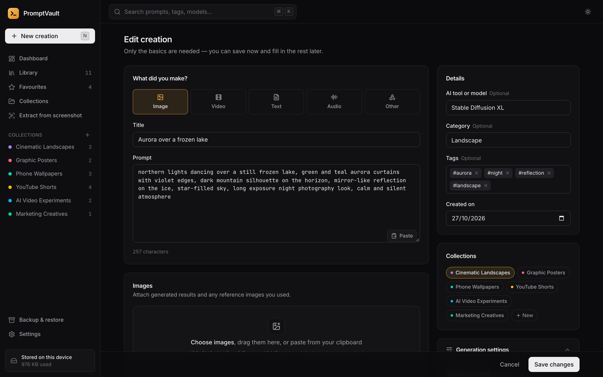 | 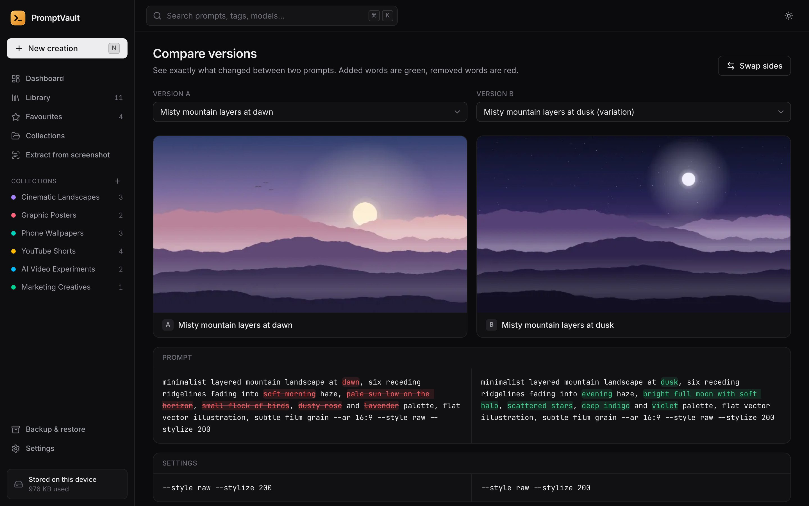 |
| **Collections** | **List view** |
| 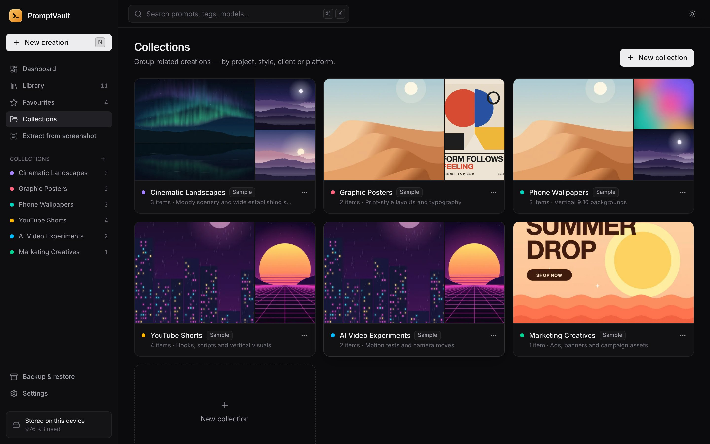 | 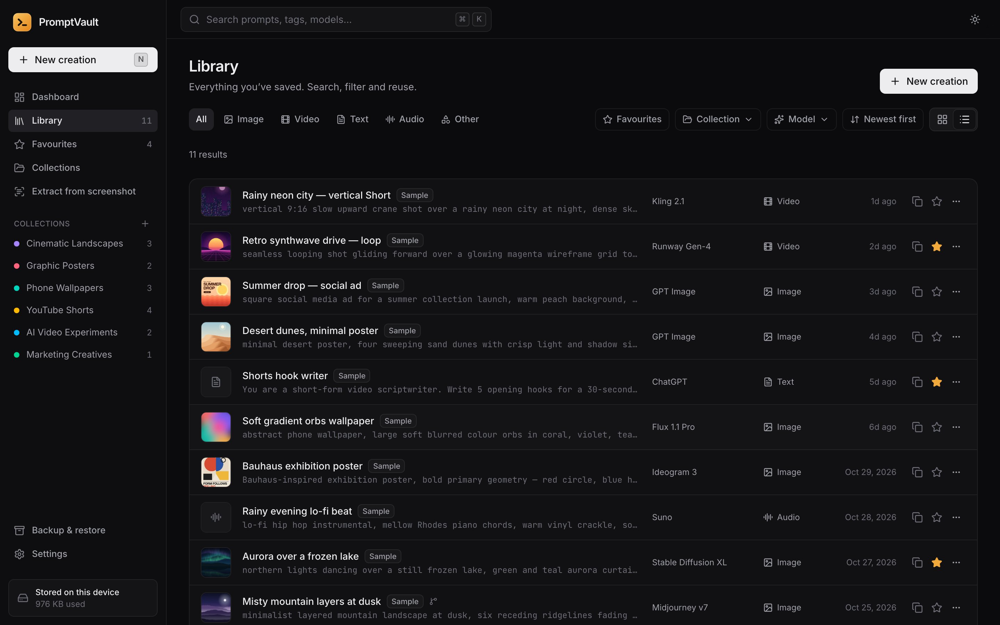 |
| **Extract a prompt from a screenshot** | **Backup & restore** |
| 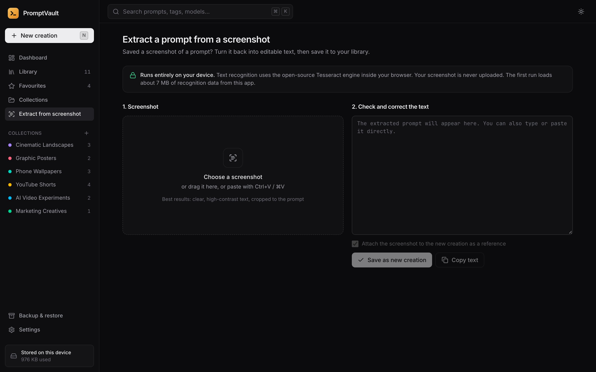 | 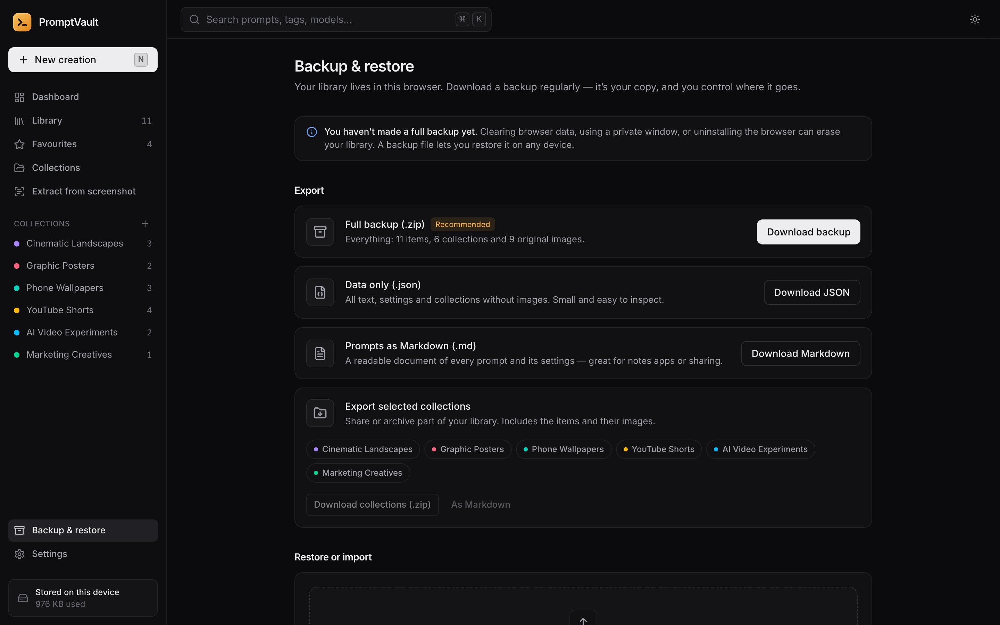 |
| **Light theme** | **Video record** |
| 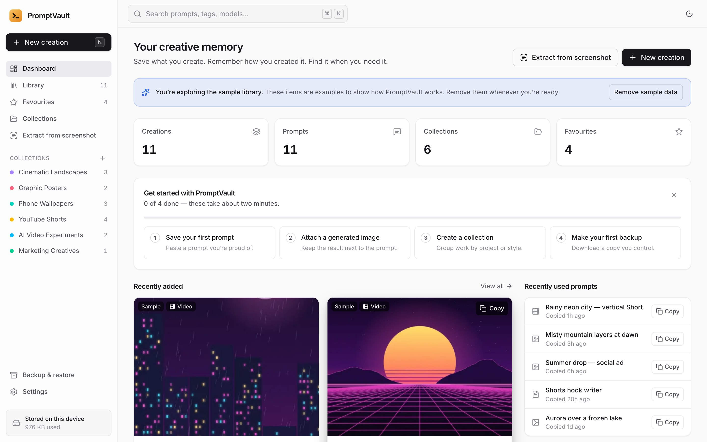 | 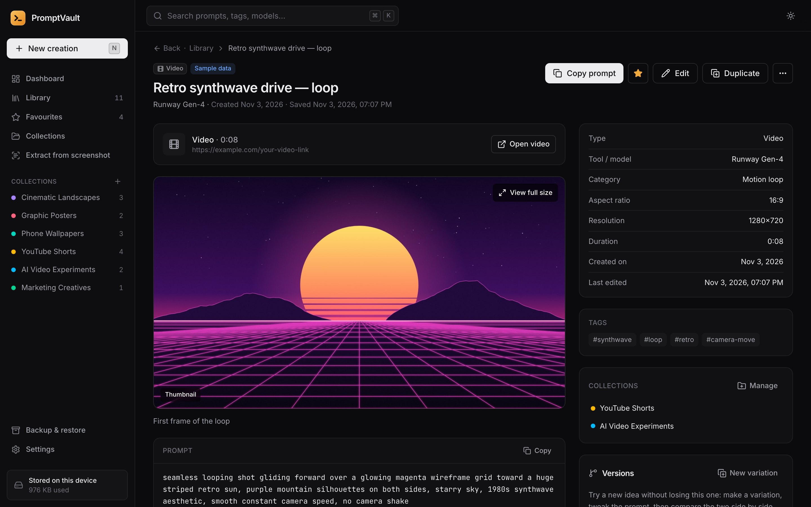 |

<p align="center">
  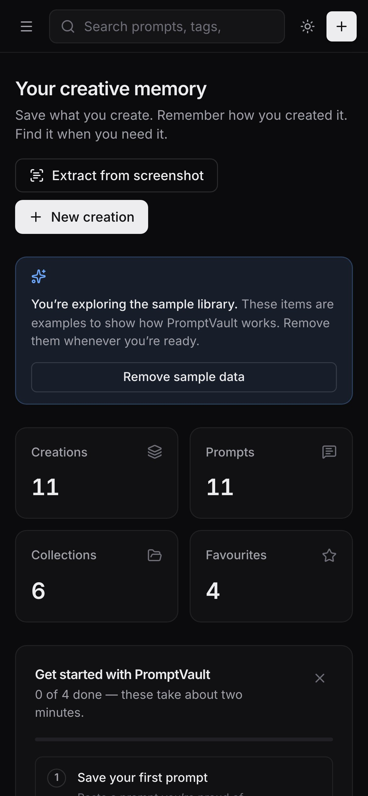
  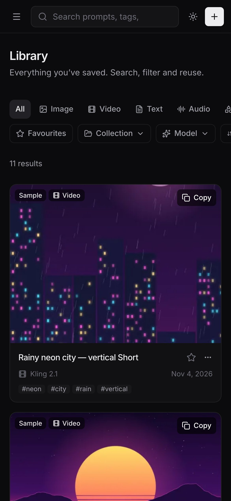
  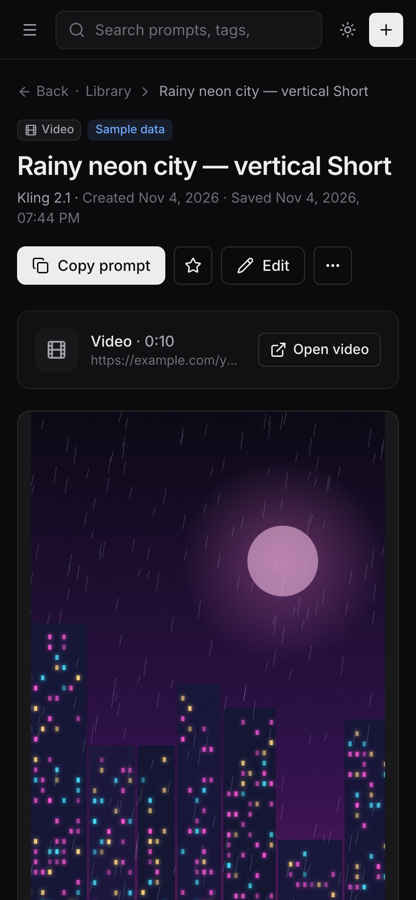
</p>

## Getting started

### Use it in your browser

Open **[kapoorraghav-cmd.github.io/promptvault](https://kapoorraghav-cmd.github.io/promptvault/)**. Nothing to install. Your library is saved in that browser on that device.

### Run it on your own computer

You'll need [Node.js](https://nodejs.org/) 22.12 or newer (the "LTS" download is fine).

```bash
git clone https://github.com/kapoorraghav-cmd/promptvault.git
cd promptvault
npm install
npm run dev
```

Then open the address it prints (usually http://localhost:5173).

### Build for production

```bash
npm run build     # creates a static site in dist/
npm run preview   # serves the build at http://localhost:4173
```

The `dist/` folder is a plain static website. You can host it anywhere that serves files (GitHub Pages, Netlify, an internal web server, etc.). No server-side code is needed.

### Run the checks

```bash
npm run lint        # code style
npm run typecheck   # TypeScript
npm test            # unit tests (Vitest)
npx playwright install   # one-time: download test browsers
npm run test:e2e    # end-to-end tests in Chromium, Firefox, WebKit and mobile viewports
```

## Privacy architecture

Privacy is a core design decision, not a setting.

- **No server, no account, no analytics.** PromptVault is a static web app. There is no backend to send data to and no tracking code.
- **Local storage only.** Your prompts, notes and images are stored in your browser's built-in database (IndexedDB) on your device.
- **No third-party requests.** Fonts and the OCR engine are bundled with the app. The production build ships a Content Security Policy with `connect-src 'self'`, which blocks the app from contacting other servers. The end-to-end tests check that OCR makes no external requests.
- **Safe handling of files.** Uploaded images are checked by their actual file signature, not their name. SVG and other formats that can contain scripts are refused. Uploaded content is only ever displayed as an image, never executed.
- **Safe rendering.** All text is rendered as plain text (no raw HTML). Saved links only open if they're `http(s)` links, and only when you click them.
- **Safe imports.** Backup files are size-limited and every record is validated before anything is written. Invalid entries are skipped and reported.

**What this does _not_ mean.** PromptVault doesn't encrypt your data. Anyone who can use your browser profile can open your library, so don't store passwords or secrets in prompts. If you host your own copy, your web host can see normal access logs, as with any website.

## How your data is stored

| What | Where |
| --- | --- |
| Creations, collections and settings | IndexedDB in your browser (`promptvault` database) |
| Original images | IndexedDB, stored untouched (no compression or resizing) |
| Image previews | IndexedDB, small copies generated for fast grids |
| Theme and view preferences | `localStorage` (tiny, no library data) |
| Video files | Not stored. PromptVault saves the link you provide |

Things to know:

- **Data is per browser and per device.** Chrome and Safari on the same computer have separate libraries. Nothing syncs automatically. Use a backup file to move your library.
- **Browsers can clear data.** Clearing site data, using a private/incognito window, or some browsers' automatic clean-up when storage is low can erase your library. In Settings → Storage you can ask the browser to protect PromptVault's data, but the safest option is a regular backup.
- **Storage limits.** Browsers give each site a share of free disk space (often several gigabytes). Settings shows how much you're using. Each image can be up to 40 MB.

## Backup and restore

**To make a backup**
1. Open **Backup & restore** in the sidebar.
2. Click **Download backup**. A file like `promptvault-backup-2026-11-05.zip` is saved to your Downloads folder.
3. Store it somewhere safe: cloud storage, a USB drive or another computer.

**To restore**
1. Open PromptVault (on any device or browser) and go to **Backup & restore**.
2. Click **Choose a backup file** and pick your `.zip` or `.json` backup.
3. Check the preview. If some items already exist, choose to keep yours, replace them, or keep both.
4. Click **Import**.

**Formats**
- **Full backup (.zip):** everything, including original images. Use this for real backups.
- **Data only (.json):** all text, settings and collections, without images. Human-readable.
- **Markdown (.md):** a readable document of prompts and settings for notes apps or sharing. It can't be imported back.

The backup format is documented in [`docs/ARCHITECTURE.md`](docs/ARCHITECTURE.md#backup-format).

## Technology

| Area | Choice | Why |
| --- | --- | --- |
| UI | [React](https://react.dev) 19 + [TypeScript](https://www.typescriptlang.org) | Mature, widely known, type-safe |
| Build | [Vite](https://vite.dev) | Fast development and a small static build |
| Styling | [Tailwind CSS](https://tailwindcss.com) 4 with a custom design system | Consistent spacing, colour and dark/light themes |
| Accessible primitives | [Radix UI](https://www.radix-ui.com) (dialogs, menus, tooltips, switch) | Keyboard and screen-reader support |
| Icons | [Lucide](https://lucide.dev) | Clean, consistent icon set |
| Storage | [Dexie](https://dexie.org) on IndexedDB | Reliable local database with live queries |
| Search | [MiniSearch](https://lucaong.github.io/minisearch/) | Fast full-text search in the browser |
| OCR | [Tesseract.js](https://tesseract.projectnaptha.com) (bundled, English) | Open-source text recognition that runs locally |
| Backups | [fflate](https://github.com/101arrowz/fflate) + [Zod](https://zod.dev) | Zip files in the browser; strict validation on import |
| Tests | [Vitest](https://vitest.dev) + [Playwright](https://playwright.dev) | Unit tests and real-browser end-to-end tests |

Fonts: [Inter](https://rsms.me/inter/) and [JetBrains Mono](https://www.jetbrains.com/lp/mono/), both bundled under the SIL Open Font Licence.

## Roadmap

**Available now (v1.0)**
- [x] Local library with images, video links, text and audio prompts
- [x] Search, filters, sorting, grid/list views
- [x] Collections, tags and favourites
- [x] Variations with side-by-side comparison
- [x] On-device OCR for prompt screenshots
- [x] Full backup/restore (.zip), JSON and Markdown export, selective export
- [x] Dark/light themes, onboarding, sample library, responsive layout

**Planned**
- [ ] Install as an app and work fully offline (service worker / PWA)
- [ ] Bulk select: tag, move and export many items at once
- [ ] More OCR languages
- [ ] Browser extension to save prompts from AI platforms in one click
- [ ] Optional, opt-in sync between devices
- [ ] Semantic ("find similar") search that runs locally
- [ ] Shareable public collections

**Exploring (would be optional and clearly disclosed)**
- [ ] Optional AI-powered prompt suggestions using your own API key
- [ ] Prompt performance notes and comparisons across models

Ideas and votes are welcome in [Issues](https://github.com/kapoorraghav-cmd/promptvault/issues).

## Contributing

Contributions of all sizes are welcome — bug reports, ideas, docs and code. Please read [CONTRIBUTING.md](CONTRIBUTING.md) to get set up, and follow the [Code of Conduct](CODE_OF_CONDUCT.md).

## Support and reporting issues

- **Found a bug?** [Open a bug report](https://github.com/kapoorraghav-cmd/promptvault/issues/new?template=bug_report.yml). Please include your browser and steps to reproduce. Don't attach private prompts or images.
- **Have an idea?** [Suggest a feature](https://github.com/kapoorraghav-cmd/promptvault/issues/new?template=feature_request.yml).
- **Security issue?** Please report it privately as described in [SECURITY.md](SECURITY.md).

## Licence

PromptVault is released under the [MIT Licence](LICENSE). © 2026 Raghav Kapoor.

The images in the sample library are original illustrations generated in code by [`scripts/generate-sample-art.mjs`](scripts/generate-sample-art.mjs). The tool and model names in the sample records are illustrative examples and don't imply any affiliation with, or endorsement by, those products.
